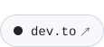
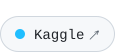
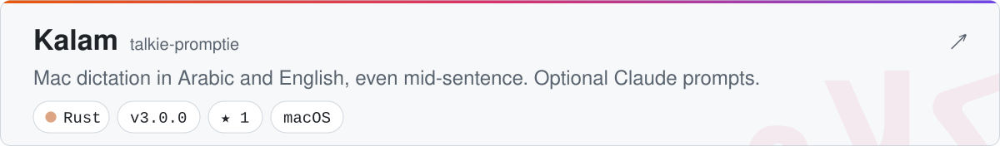
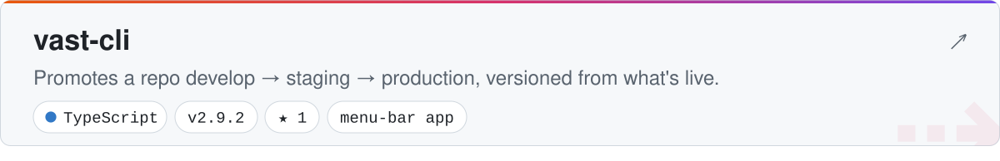
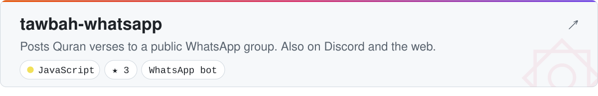
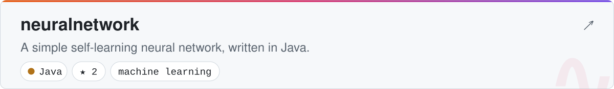
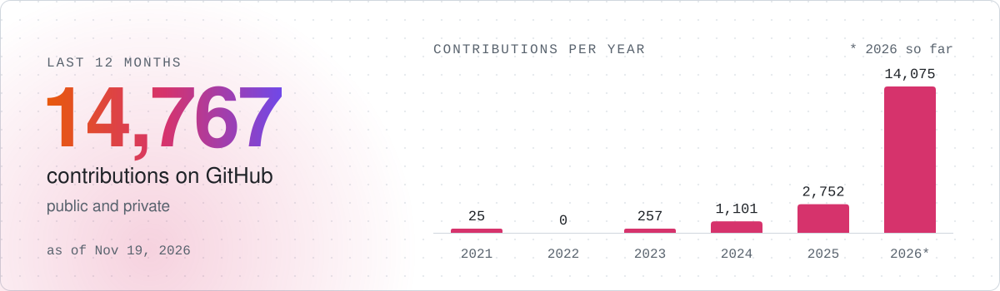

<picture>
  <source media="(max-width: 600px)" srcset="assets/hero-mobile.svg">
  <source media="(prefers-color-scheme: dark)" srcset="assets/hero-dark.svg">
  
</picture>

  <a href="https://linkedin.com/in/mostafa-adly-139b65277"><picture><source media="(prefers-color-scheme: dark)" srcset="assets/link-linkedin-dark.svg"></picture></a>&nbsp;<a href="https://dev.to/mostafaadly"><picture><source media="(prefers-color-scheme: dark)" srcset="assets/link-devto-dark.svg"></picture></a>&nbsp;<a href="https://stackoverflow.com/users/21976653"><picture><source media="(prefers-color-scheme: dark)" srcset="assets/link-stackoverflow-dark.svg"></picture></a>&nbsp;<a href="https://kaggle.com/mostafaadly"><picture><source media="(prefers-color-scheme: dark)" srcset="assets/link-kaggle-dark.svg"></picture></a>&nbsp;<a href="https://leetcode.com/mostafaadly"><picture><source media="(prefers-color-scheme: dark)" srcset="assets/link-leetcode-dark.svg"></picture></a>

## What I work on

🍽️ **Product · VastMenu & VastPay.** Restaurant ordering and [multi-tenant payments](https://vastpay.app) at Vast Group. I work on both end to end: Laravel backends, PWAs and their Next.js rewrites, Vue dashboards, and a Tap payments service.

🛠️ **Platform · the release train.** I built Vast Group's release tooling. **EL-Komsary** (⁧الكومسري⁩, the ticket inspector) reviews pull requests with Claude and stamps each one ⁧ينفع⁩ (ship it), ⁧ينفع بس⁩ (yes, but) or ⁧مش هينفع⁩ (won't fly). Vast Releases gives pull requests preview environments and end-to-end runs, and [`vast-cli`](https://github.com/MostafaAdly/vast-cli) carries each release from develop to production.

🤖 **AI · Kallm.** I'm building [Kallm Agent](https://agent.kallmai.com) solo: AI agents that sign in to your tools and finish real work, asking before they send, pay or delete. Private beta in Egypt. I also build [KallmAI](https://kallmai.com): 100+ models in one workspace, paid with Egyptian payment methods.

🎨 **Agency · Pimula.** Client work like Shadoo, where I build across its Rails API, Next.js web app and Expo mobile app.

## Open source

  <a href="https://github.com/MostafaAdly/talkie-promptie"><picture><source media="(max-width: 600px)" srcset="assets/card-talkie-promptie-mobile.svg"><source media="(prefers-color-scheme: dark)" srcset="assets/card-talkie-promptie-dark.svg"></picture></a>
  <a href="https://github.com/MostafaAdly/vast-cli"><picture><source media="(max-width: 600px)" srcset="assets/card-vast-cli-mobile.svg"><source media="(prefers-color-scheme: dark)" srcset="assets/card-vast-cli-dark.svg"></picture></a>
  <a href="https://github.com/MostafaAdly/tawbah-whatsapp"><picture><source media="(max-width: 600px)" srcset="assets/card-tawbah-whatsapp-mobile.svg"><source media="(prefers-color-scheme: dark)" srcset="assets/card-tawbah-whatsapp-dark.svg"></picture></a>
  <a href="https://github.com/MostafaAdly/neuralnetwork"><picture><source media="(max-width: 600px)" srcset="assets/card-neuralnetwork-mobile.svg"><source media="(prefers-color-scheme: dark)" srcset="assets/card-neuralnetwork-dark.svg"></picture></a>

## By the numbers

<picture>
  <source media="(max-width: 600px)" srcset="assets/stats-mobile.svg">
  <source media="(prefers-color-scheme: dark)" srcset="assets/stats-dark.svg">
  
</picture>

## Toolbox

  <picture>
    <source media="(prefers-color-scheme: dark)" srcset="https://skillicons.dev/icons?i=ts%2Cjs%2Cphp%2Cruby%2Cgo%2Crust%2Cswift%2Cjava%2Cpy%2Cpostgres%2Cmysql%2Cnextjs%2Creact%2Cvue%2Claravel%2Crails%2Cexpress%2Ctauri%2Caws%2Cdocker%2Ckubernetes%2Ccloudflare%2Cgithubactions%2Clinux&perline=12&theme=dark">
    
  </picture>

## How I got here

⛏️ **Minecraft plugins.** Five years of paid Java plugins for Spigot servers.

🕌 **Bots.** Tawbah, a reports bot, and a WhatsApp prayer bot.

🎓 **Engineering.** Electronics & Communications Engineering at Canadian International College, plus the DEPI DevOps track. Graduation project in 2024.

<picture>
  <source media="(max-width: 600px)" srcset="assets/footer-mobile.svg">
  <source media="(prefers-color-scheme: dark)" srcset="assets/footer-dark.svg">
  
</picture>
